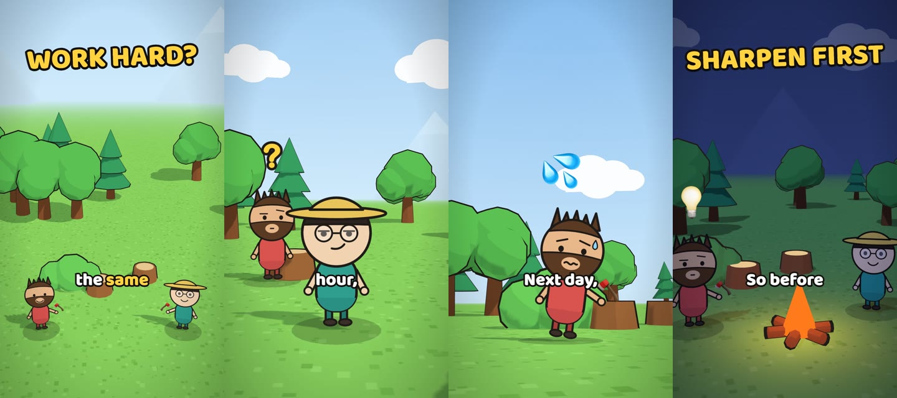
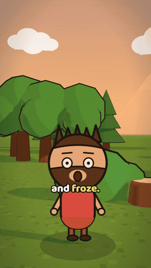

# storytoon

A Claude skill that makes those cartoon story shorts: flat 2D characters walking around a 3D world while a narrator tells a small fable and the captions pop one or two words at a time.



I kept seeing this format pull millions of views and wanted a way to make them without paying for image or video generation on every single short. So everything here is drawn in code. The voice is free too. You type a topic, Claude writes the story, and about six minutes later there is an mp4.



## Install

You need Node 18+, Python 3.9+ and Chrome (or Edge) on your machine. Then:

```bash
git clone https://github.com/themembershipguru/storytoon-skill ~/.claude/skills/storytoon
```

Open Claude Code in any folder and say something like:

```
make a story reel: why the slow woodcutter beat the strong one
```

or in Hindi:

```
kahani reel banao: do dost, ek ne skill seekhi, ek ne shortcut liya
```

The first run copies the project next to you and does an `npm install`, so give it a few minutes. After that it is quick.

## What actually happens

1. Claude writes the script and shows it to you. Nothing gets built until you say yes. (This saves a lot of wasted renders.)
2. It fills in one file, `story/story.json`: who is in the story, where they stand, what the camera does, what the narrator says.
3. It renders a still of every scene and looks at them, because the first attempt always has someone standing half outside the frame.
4. Voice, one more check, final render. You get a 1080x1920 mp4, a caption and hashtags.

Videos come out around 80 to 100 seconds unless you ask for shorter.

## Don't know what to make?

There is a research command for that:

```bash
npm run research -- "money lessons" --tags moneytips,personalfinance
```

It looks through YouTube (with yt-dlp, no API key) for shorts in that niche with a million views or more, and pulls the opening line, the pace and the transcript into one file. Claude reads that, works out what the winners have in common, and pitches you original ideas built on the same patterns.

Fair warning: YouTube search is messy. You will get some pranks and music clips mixed in, and plenty of shorts have no captions to read. Good hashtags help a lot.

## What is in it

- People with different hair, hats, glasses and beards, plus an owl who does the teaching at the chalkboard
- Ten expressions, and actions like talk, walk, hop, cheer, work and sleep
- Grass, sand, cobblestone, snow and more; day, sunset and night
- Houses, towers, trees, log piles, coins, a market stall, a campfire, street lamps, fields, ponds
- Any emoji as a prop. This sounds like a hack and it is, but it means you never run out of objects.
- Wide, medium, close, top-down and low camera shots, with push-ins, orbits and whip cuts

Everything `story.json` understands is listed in [references/story-schema.md](references/story-schema.md). How the stories are put together is in [references/story-craft.md](references/story-craft.md).

## Running it without Claude

```bash
cd template
npm install
npm run check     # a still per scene, in out/check
npm run voice     # narration and caption timing
npm run render    # out/two-woodcutters.mp4
```

`npm run studio` gives you a live preview. The sample story in `template/story/story.json` is the easiest way to learn the format: change a line, run check, see what moved.

## Things it can't do (yet)

- No music or sound effects. Drop your own track at `template/public/music.mp3` and it will play quietly under the voice.
- One art style. More are planned.
- The characters are simple on purpose. If you want film-quality 3D, this is the wrong tool.
- On a Linux server with no GPU, set `STORYTOON_GL=swangle`.

## A few asks

- Write your own stories. Borrow the format from videos you like, not their script or characters. Copies get strikes, and people have already seen the original anyway.
- If your story is made up, don't present it as something that really happened.
- The narrator is a synthetic voice. Label it where the platform asks you to.
- The free voice goes through Microsoft Edge's read-aloud service (the `edge-tts` package), and research reads public YouTube pages. Have a look at their terms for how you plan to use this.

## Licence

MIT, do what you like. It is built on [Remotion](https://remotion.dev), which is free for individuals and small teams but needs a licence for bigger companies.

If you make something with it, I would love to see it. Open an issue and drop the link.
